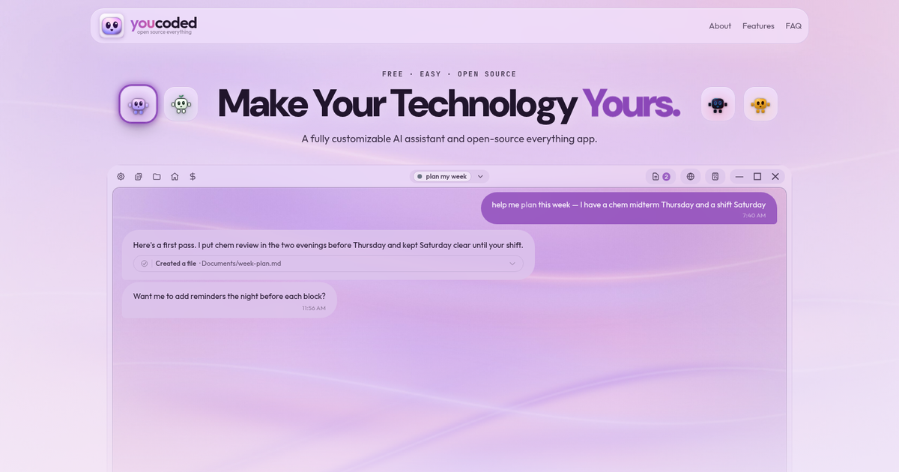
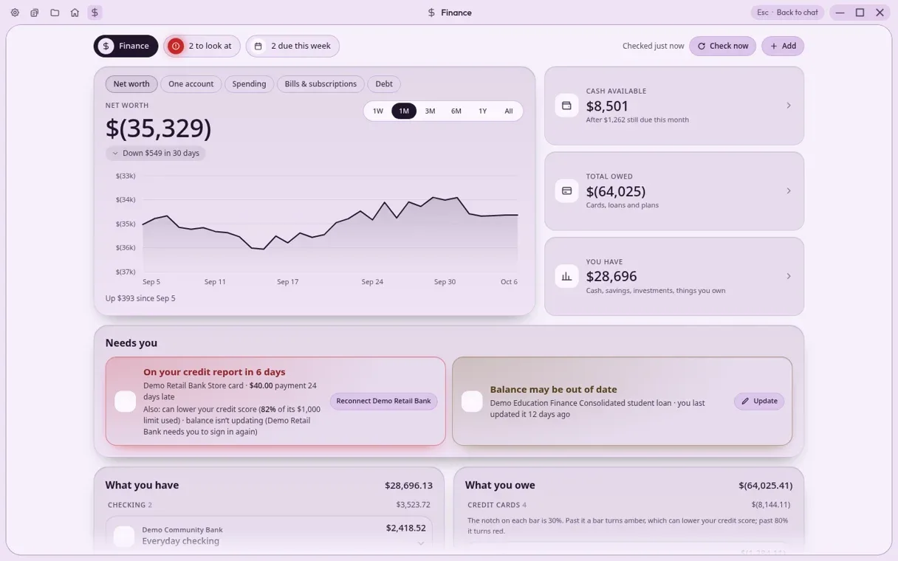
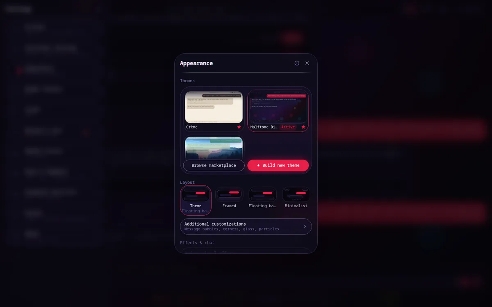
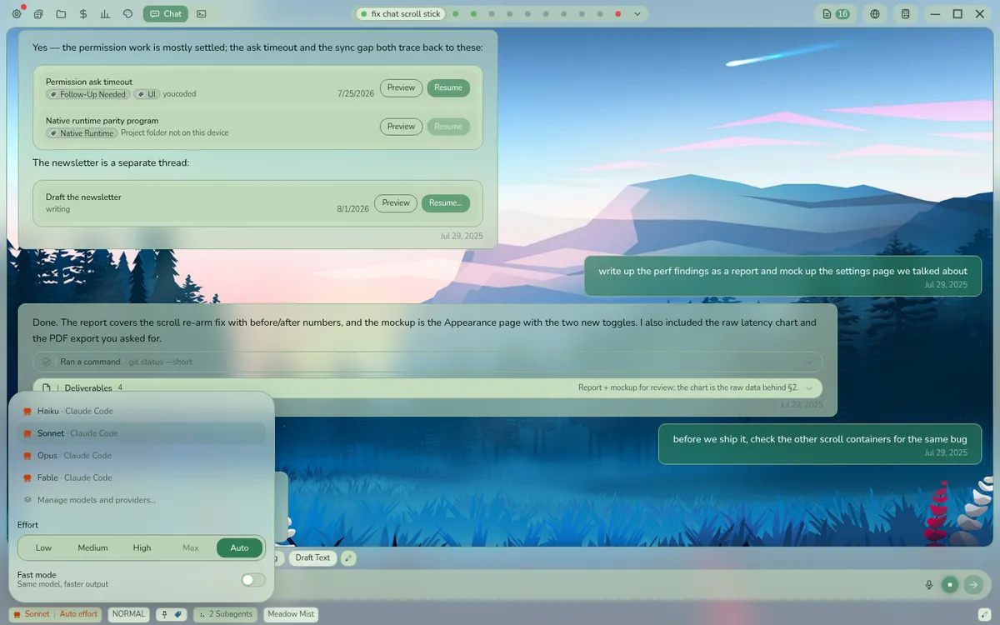

# YouCoded

**Your personal AI assistant and open source everything app.** Make your technology useful, fun, and yours.

Free and MIT-licensed, for Windows, macOS, Linux and Android, plus any web browser through remote access. Download at **[youcoded.ai](https://youcoded.ai)**.

<p align="center">
  
</p>

---

## What is YouCoded?

YouCoded is an AI assistant that becomes what you ask it to be. Hand it your files, your research and your writing. Ask it for a control panel for your house, a page for your money, or a game for a slow afternoon. Ask it to change its own look, give itself new features, or handle your requests differently. It builds those inside the app, on whichever AI model you choose.

That last part matters. YouCoded runs on Claude or ChatGPT through the plan you already pay for, on hundreds of models through OpenRouter, on your own API keys, or on an open model running privately on your own computer for free. You are never locked into one company, and nothing you build disappears if you stop paying one of them.

It asks before it acts. Every standing permission sits on one screen where you can revoke it, and the whole app is open source, so anyone can check exactly what it does.

### Why it exists

For years, the deal with software has been the same: rent it, never own it, and work the way the company that made it decided you should. AI changes that deal. Anything a private company can build, a community of people who care can now build better, and you no longer need to know how to code to take part.

YouCoded is built on that idea. Every line of it was written through conversation with AI by someone who has never written code: every feature, every platform, every theme and every game. It started as a journaling system run from a terminal, which none of my friends would touch, so I kept asking the AI to make it friendlier until it became this. Developer tools assume you know how to code; YouCoded is built for everyone else, so that anyone can make their software better.

The goal is an app owned by nobody and improved by everybody, and eventually one you can run and keep improving entirely on your own hardware, with no subscription and no internet connection at all.

— Destin

> **Disclaimer:** YouCoded is an independent, community-built project. It is not affiliated with, endorsed by, or officially supported by Anthropic, OpenAI or OpenRouter.

## What you can do with it

| | |
|---|---|
|  |  |
| **A page for your home**, made by asking for one: lights, thermostat, speakers and TVs on one screen. | **A page for your money**: every account, bill and loan, arranged the way you wish your bank did. |
|  |  |
| **A whole new look**, described in a sentence: wallpaper, colors, fonts, an animated mascot. | **Any AI model**, from the best cloud models to a free one on your own computer. |

The home and money pages are examples one person asked for and uses daily; they do not ship with the app. Yours will be different.

## Features

**Make it yours**
- **Pages:** small apps that live inside YouCoded, follow its theme and pin to the header. Describe what you want with `/page-builder` and it builds it, from a budget tracker to a trip planner to a paint program.
- **Themes:** six built in (Light, Dark, Midnight, Crème, YouCoded, YouCoded Night), plus community theme packs. `/theme-builder` turns a description into a full theme with wallpaper, colors, a Google font, particle effects and a mascot.
- **Skills:** install new abilities from the community marketplace, or make your own and share them with friends through a link or by publishing to the marketplace from inside the app.

**Any AI model**
- Claude through your Claude plan (YouCoded runs Claude Code for you, with a full chat interface on top).
- ChatGPT through your ChatGPT plan.
- Hundreds of models through one [OpenRouter](https://openrouter.ai/) account.
- Your own API keys for Anthropic, OpenAI or Google, or any OpenAI-compatible provider you add.
- **Free, private, offline models** on your own computer. YouCoded ships its own engine (llama.cpp), so you can download a model in the app and go, with no Ollama required. It also finds Ollama or LM Studio if you already run them. Idle models unload themselves after 15 minutes.
- Switch models in the middle of a conversation with YouCoded's own assistant. If the conversation is too long for the new model, it offers to summarize first.

**Work on your files**
- YouCoded's own assistant reads and edits files, runs commands, searches the web, uses connected tools (MCP servers) and hands parts of a job to specialists that can keep working in the background.
- Attach a spreadsheet, document or folder and ask for what you want out of it. Results open in a panel beside the conversation where you can read them, change them and hand them back.
- Edit Word, Excel and PowerPoint files inside the desktop app, with autosave, a version history of every change, and PDF export.
- Comments on documents, like Google Docs: you and the assistant can both add and resolve them, even in a file that is open in the editor.
- On desktop, give the assistant a browser it can read, click and type in, with its own approval cards and a view you can follow along with.
- Run admin (sudo) commands from the chat through a password card, with approvals scoped to what you allow.

**You stay in control**
- It asks before it acts. Three permission modes (Ask first, Auto edit, Full Auto) set how much it may do on its own.
- Every standing permission is listed on one screen, each with its own Revoke button.
- YouCoded never receives what you send to an AI model. A model running on your own computer never sends it anywhere.

**Every device**
- Start on your laptop, finish on your phone. Conversations and files sync through your own private GitHub repository, with an optional daily backup to Google Drive or iCloud.
- Hand a conversation off from one computer to another.
- The Android app runs the assistant on the phone itself, Claude Code included, rather than remote-controlling a computer.
- Reach your desktop from any web browser or from the Android app over [Tailscale](https://tailscale.com/), pairing a phone by QR code.
- Voice typing. On desktop, speech is turned into text on your own computer.

**Stay organized**
- Projects keep files, conversations and instructions together.
- Tag conversations, add notes, pin the ones that matter and mark finished ones complete. Conversation Search finds anything you talked about before.
- Quick chips run the prompts you use every day in one tap.
- A status bar with 19 widgets you can turn on or off.
- Several conversations at once, each in its own tab or its own window. Developers also get a full terminal view and git review.

**Play while it works**
- Long tasks take a minute, so open the arcade beside the conversation: chess and Connect Four against friends who are online, or Flappy and 2048 on your own.
- A friends list with challenges and head-to-head records. Turn on **Incognito** to stay hidden.

## Download

| Platform | Get it |
|----------|--------|
| Windows 10+ | `YouCoded-Installer-<version>.exe` from [Releases](https://github.com/itsdestin/youcoded/releases/latest) |
| macOS 12+ (Apple silicon or Intel) | `.dmg` from [Releases](https://github.com/itsdestin/youcoded/releases/latest) |
| Linux (x64) | `.AppImage`, `.deb` (Debian/Ubuntu), `.rpm` (Fedora) or `.pacman` (Arch) from [Releases](https://github.com/itsdestin/youcoded/releases/latest) |
| Android 9+ (arm64) | `.apk` from [Releases](https://github.com/itsdestin/youcoded/releases/latest) |
| Any web browser | Remote access to a computer running YouCoded |

The app updates itself. Some features are desktop-only: the local model engine, Office editing, the assistant's browser and on-device voice typing.

## What it costs

The app is free. Running a model on your own computer costs nothing. Cloud models are paid to the provider you choose: a Claude or ChatGPT plan, or pay-as-you-go through OpenRouter or your own API key. A free GitHub account keeps your conversations and files in sync across devices.

## Help build it

YouCoded is meant to be built together, and you do not need to write code to help. You can:

- **Report bugs and suggest ideas** in [Issues](https://github.com/itsdestin/youcoded/issues). Say what you did, what happened and what you expected.
- **Share what you make.** Skills go to the [YouCoded marketplace](https://github.com/itsdestin/wecoded-marketplace) and themes to [YouCoded Themes](https://github.com/itsdestin/wecoded-themes), both straight from inside the app.
- **Send changes.** Fork, branch, and open a pull request against `master`, one change per pull request, explaining what a user will notice. Building it with AI is welcome; that is how the whole app was made. Commits need a sign-off line (`git commit -s`); see [CONTRIBUTING.md](./CONTRIBUTING.md) for the how and why.

Security problems go through [SECURITY.md](./SECURITY.md), not a public issue.

## Building from source

### Desktop (Electron)

```bash
git clone https://github.com/itsdestin/youcoded.git
cd youcoded/desktop
npm ci
npm run dev       # Development mode with hot reload
npm test          # Run tests
npm run build     # Build distributable installer
```

### Android

The Android runtime currently builds on **Linux x64**; on Windows or macOS, use a Linux x64 environment such as WSL or a VM. It needs an Android SDK, JDK 21, Node.js/npm, Bash, Python 3, curl, tar, make, clang and lld. Gradle builds the shared React UI and desktop backend and downloads the pinned runtime programs. See [Android runtime](docs/android-runtime.md) for details and side-by-side development builds.

```bash
git clone https://github.com/itsdestin/youcoded.git
cd youcoded
./gradlew assembleDebug
```

Debug APK at `app/build/outputs/apk/debug/app-debug.apk`.

### Project structure

```
youcoded/
  desktop/     # Electron app (Windows, macOS, Linux) and the shared React UI
  app/         # Android shell, WebView and bundled headless desktop backend
  docs/        # The youcoded.ai website and subsystem docs
  scripts/     # Shared build scripts
```

## Related projects

- [YouCoded Marketplace](https://github.com/itsdestin/wecoded-marketplace): community skills and plugins
- [YouCoded Themes](https://github.com/itsdestin/wecoded-themes): community theme packs
- [YouCoded Office](https://github.com/itsdestin/youcoded-office): the document editor add-on (AGPL)
- [YouCoded Core](https://github.com/itsdestin/youcoded-core): archived legacy plugin; current apps bundle their own safety hooks

## Privacy and policies

The app sends one opt-out daily heartbeat: a hashed device identifier, app version, platform and rough region, with no message content or username. The multiplayer lobby shares your GitHub username and online status with other signed-in players unless you turn on Incognito.

- [Privacy Policy](./PRIVACY.md)
- [Terms of Service](./TERMS.md)
- [Security Policy](./SECURITY.md)

## License

YouCoded-authored code, shared UI, scripts and docs are **MIT** unless stated otherwise. See the root [LICENSE](LICENSE); copies also live at [desktop/LICENSE](desktop/LICENSE) and [app/LICENSE](app/LICENSE).

Bundled third-party components retain their own licenses. Android includes Alpine programs and libraries (including GPL/LGPL components), modified musl, npm packages and Claude Code under separate terms. The release-specific inventory, offline notices and corresponding-source materials must accompany redistribution; the app's MIT license does not replace their requirements. See [Android redistribution](docs/android-redistribution.md) for the fail-closed packaging gate and unresolved review requirements.
