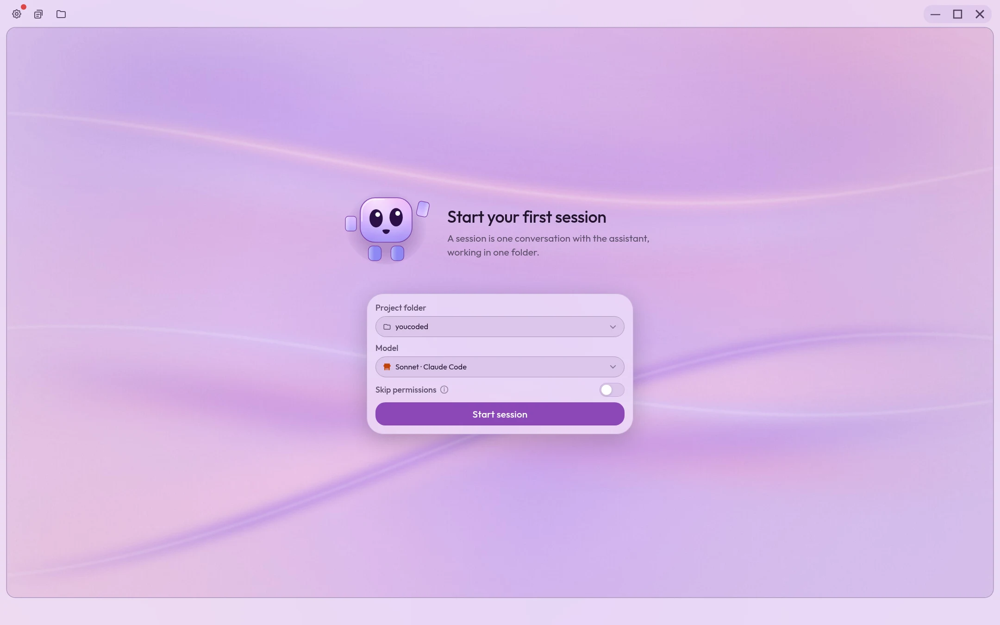
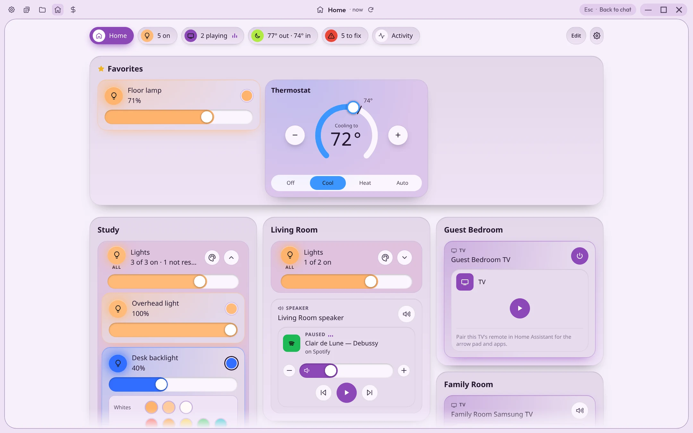
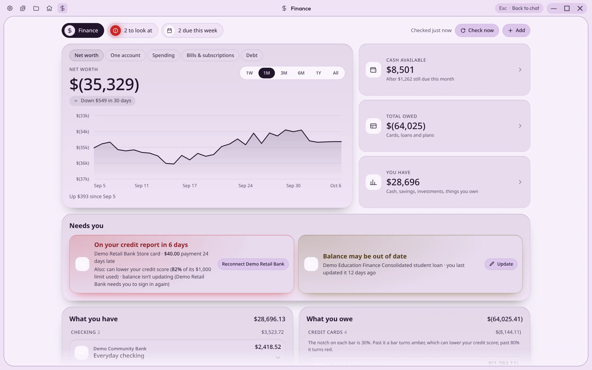

# YouCoded

**Your personal AI assistant and open source everything app.** Make your technology useful, fun, and yours.

Free and MIT-licensed, for Windows, macOS, Linux and Android, plus any web browser through remote access. Download at **[youcoded.ai](https://youcoded.ai)**.

<!-- WHY: screenshots are of the default YouCoded theme, taken with the workspace's shoot tool (practice data, no real accounts). Retake with: node scripts/shoot/shoot.mjs welcome office/spreadsheet 'pages/focus/page-home#site' 'pages/focus/page-money#site' --themes youcoded --width 1440 --height 900 -->
<p align="center">
  
  
</p>
<p align="center">
  
  
</p>
<p align="center"><sub>The Home and Finance pages are examples one person asked for and uses daily. They don't ship with the app; yours will be different. The data shown is invented.</sub></p>

---

## What is YouCoded?

An AI assistant that does what you want, the way you want, with the screens and features you want. Hand it your files, your research and your writing. Ask it for a control panel for your house, a page for your money, or a game for a slow afternoon. Ask it to change its own look, give itself new features, or handle your requests differently.

It runs on whichever AI you choose: Claude or ChatGPT on the plan you already pay for, hundreds of models through OpenRouter, your own API keys, or an open model running privately on your own computer for free.

Nothing happens without your permission. It asks before it acts, and the whole app is open source, so anyone can check what it does.

> **Disclaimer:** YouCoded is an independent, community-built project. It is not affiliated with, endorsed by, or officially supported by Anthropic, OpenAI or OpenRouter.

## Features

**Make it yours**
- **Themes:** describe a look and `/theme-builder` makes it: wallpaper, colors, fonts, effects and an animated mascot. Six built in, plus community theme packs.
- **Pages:** small apps that live inside YouCoded and follow its theme. Describe one with `/page-builder`, from a budget tracker to a trip planner to a paint program.
- **Skills:** install new abilities from the community marketplace, or make your own and share them.
- **Your whole device (Linux):** build control-center widgets, quick-settings chips and utilities that change how your computer works. [Swipe Keyboard for KDE Plasma](https://github.com/itsdestin/swipe-keyboard#readme) is one example.

**Any AI model**
- Claude on your Claude plan, ChatGPT on your ChatGPT plan, hundreds of models through one [OpenRouter](https://openrouter.ai/) account, or your own API keys.
- Free, private, offline models on your own computer, with a built-in engine (no Ollama required).
- Switch models mid-conversation. Your tools and conversations work the same on all of them.

**Work on your files**
- Attach a spreadsheet, document or folder and ask for what you want out of it. Results open beside the conversation, where you can read them, change them and hand them back.
- Edit Word, Excel and PowerPoint files inside the desktop app, with version history and PDF export. You and the assistant can both leave comments.
- On desktop, give the assistant a browser it can read, click and type in, with your approval.

**Connect your services**
- Skills from the marketplace link YouCoded with Google Drive, Docs, Sheets, Slides, Calendar, Gmail and Messages; Apple iMessage, iCloud, Notes, Reminders, Calendar and Mail (macOS); Todoist, GitHub and Canva. Some need extra setup, and some are early previews.

**You stay in control**
- Three permission modes (Ask first, Auto edit, Full auto) set how much it may do on its own.
- Every standing permission is listed on one screen, each with its own Revoke button.

**Every device**
- Start on your laptop, finish on your phone. Conversations and files sync through your own private GitHub, with an optional extra backup to Google Drive or iCloud.
- The Android app runs the assistant on the phone itself, rather than remote-controlling a computer.
- Reach your computer from any web browser or the Android app over [Tailscale](https://tailscale.com/).

**Stay organized**
- Projects keep files, conversations and instructions together.
- Tag, annotate, pin and hide conversations; Conversation Search finds anything you talked about before.
- Quick chips run the prompts you use every day in one tap.
- Developers also get a full terminal view, git review and Claude Code support.

**Play while it works**
- Open the arcade beside a long task: chess and Connect Four against online friends, or Flappy and 2048 on your own. Turn on **Incognito** to stay hidden.

**On the roadmap: hand it off.** Set up a job once (what to do, which tools it may use, where to stop and check with you), then run it on a schedule or send it from your phone. Results and approvals land in an inbox.

## Download

| Platform | Get it |
|----------|--------|
| Windows 10+ | `.exe` from [Releases](https://github.com/itsdestin/youcoded/releases/latest) |
| macOS 12+ (Apple silicon or Intel) | `.dmg` from [Releases](https://github.com/itsdestin/youcoded/releases/latest) |
| Linux (x64) | `.AppImage`, `.deb`, `.rpm` or `.pacman` from [Releases](https://github.com/itsdestin/youcoded/releases/latest) |
| Android 9+ (arm64) | `.apk` from [Releases](https://github.com/itsdestin/youcoded/releases/latest) |
| Any web browser | Remote access to a computer running YouCoded |

The app updates itself. Office editing, the assistant's browser and the offline model engine are desktop-only.

## What it costs

The app is free, and running a model on your own computer costs nothing. Cloud models are paid to the provider you choose: a Claude or ChatGPT plan, or pay-as-you-go through OpenRouter or your own API key. A free GitHub account keeps your conversations and files in sync.

## How it was made

> I initially started building with AI because I wanted a cool and efficient way to journal and track my own tasks and goals. I eventually managed to develop a nifty journaling and life history system (now available in the YouCoded marketplace), and I felt compelled to share the new thing I had created. Unfortunately, the thought of installing and opening "Claude Code" in the terminal immediately scared away all of my friends. I realized that persuading others to adopt my fancy new journaling system and start building cool stuff themselves would require agentic intelligence to be much more accessible and user-friendly. Towards this end, I kind of just… kept adding things. And now we're here.
>
> — Destin

Every line of YouCoded was written through conversation with AI by someone who has never written code: every feature, every platform, every theme and every game. The goal is an app owned by nobody and improved by everybody.

## Help build it

You don't need to write code to help.

- **Report bugs and suggest ideas** in [Issues](https://github.com/itsdestin/youcoded/issues): what you did, what happened, and what you expected.
- **Share what you make.** Skills go to the [YouCoded marketplace](https://github.com/itsdestin/wecoded-marketplace) and themes to [YouCoded Themes](https://github.com/itsdestin/wecoded-themes), both from inside the app.
- **Send changes.** Fork, branch, and open a pull request against `master`, one change per pull request, saying what a user will notice. Building it with AI is welcome. Commits need a sign-off line (`git commit -s`); see [CONTRIBUTING.md](./CONTRIBUTING.md).

Security problems go through [SECURITY.md](./SECURITY.md), not a public issue.

## Building from source

### Desktop (Electron)

```bash
git clone https://github.com/itsdestin/youcoded.git
cd youcoded/desktop
npm ci
npm run dev       # Development mode with hot reload
npm test          # Run tests
npm run build     # Build distributable installer
```

### Android

The Android runtime currently builds on **Linux x64**; on Windows or macOS, use a Linux x64 environment such as WSL or a VM. It needs an Android SDK, JDK 21, Node.js/npm, Bash, Python 3, curl, tar, make, clang and lld. See [Android runtime](docs/android-runtime.md) for details and side-by-side development builds.

```bash
git clone https://github.com/itsdestin/youcoded.git
cd youcoded
./gradlew assembleDebug
```

Debug APK at `app/build/outputs/apk/debug/app-debug.apk`.

### Project structure

```
youcoded/
  desktop/     # Electron app (Windows, macOS, Linux) and the shared React UI
  app/         # Android shell, WebView and bundled headless desktop backend
  docs/        # The youcoded.ai website and subsystem docs
  scripts/     # Shared build scripts
```

## Related projects

- [YouCoded Marketplace](https://github.com/itsdestin/wecoded-marketplace): community skills and plugins
- [YouCoded Themes](https://github.com/itsdestin/wecoded-themes): community theme packs
- [YouCoded Office](https://github.com/itsdestin/youcoded-office): the document editor add-on (AGPL)
- [YouCoded Core](https://github.com/itsdestin/youcoded-core): archived legacy plugin; current apps bundle their own safety hooks

## Privacy and policies

YouCoded never receives what you send to an AI model. The app sends one opt-out daily heartbeat (a hashed device identifier, app version, platform and rough region, with no message content or username). The multiplayer lobby shares your GitHub username and online status with other signed-in players unless you turn on Incognito.

- [Privacy Policy](./PRIVACY.md)
- [Terms of Service](./TERMS.md)
- [Security Policy](./SECURITY.md)

## License

YouCoded-authored code, shared UI, scripts and docs are **MIT** unless stated otherwise. See the root [LICENSE](LICENSE) and its scope note in [NOTICE](NOTICE); copies also live at [desktop/LICENSE](desktop/LICENSE) and [app/LICENSE](app/LICENSE).

Bundled third-party components retain their own licenses. Android includes Alpine programs and libraries (including GPL/LGPL components), modified musl, npm packages and Claude Code under separate terms. The release-specific inventory, offline notices and corresponding-source materials must accompany redistribution; the app's MIT license does not replace their requirements. See [Android redistribution](docs/android-redistribution.md) for the packaging gate and review requirements.
